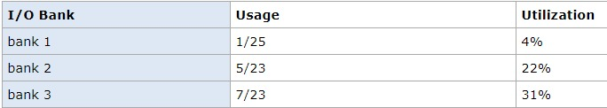
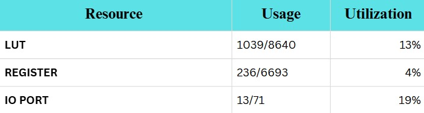
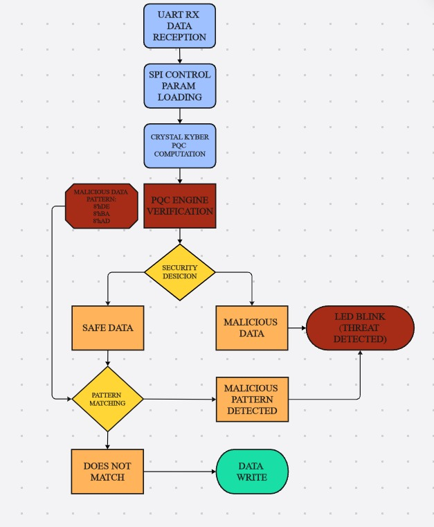
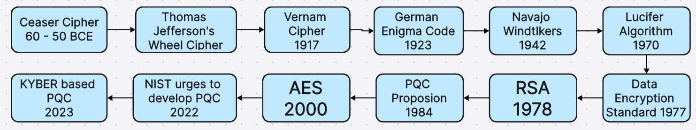
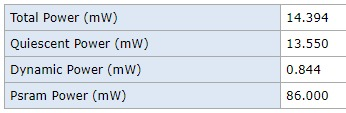
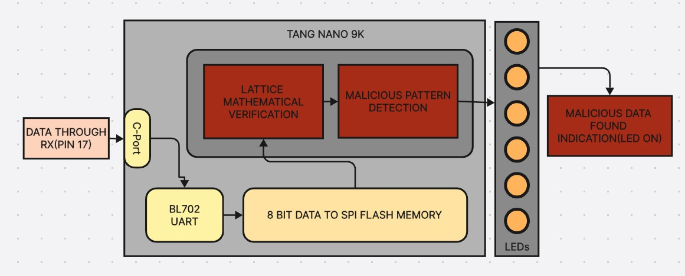

# PQC Hardware Security Engine on Tang Nano 9K

Post-Quantum Cryptography (PQC) based Hardware Security Engine / Real-Time Firewall implemented on **Sipeed Tang Nano 9K** FPGA.

Dual-layer threat detection using **Kyber-inspired lattice cryptography** + **pattern matching** for quantum-resistant embedded security.

---

## 1. About the Tang Nano 9K Board

The Tang Nano 9K is a compact, low-power FPGA development board from Sipeed, powered by the **Gowin GW1NR-LV9QN88** FPGA.

### Key Specifications

| Feature              | Details                          |
|----------------------|----------------------------------|
| FPGA Chip            | Gowin GW1NR-9                    |
| Logic Resources      | 8640 LUT4                        |
| Flip-Flops           | 6480                             |
| Block RAM            | 468 Kbit                         |
| Onboard PSRAM        | 64 Mbit                          |
| SPI Flash            | 32 Mbit                          |
| System Clock         | 27 MHz + 2 PLLs                  |
| Debugger             | Onboard BL702 (USB-JTAG + USB-UART) |
| Display Interfaces   | HDMI, RGB LCD, SPI LCD           |
| User Interfaces      | 6 LEDs, 2 Buttons, TF Card slot  |

### Board Resources

---

## 2. Project Overview

### Problem
- Classical hardware security is vulnerable to quantum attacks.
- UART / embedded communication lacks post-quantum protection.
- No real-time threat detection solution available for low-cost embedded systems.

### Solution
A dual-layer hardware security engine implemented on Tang Nano 9K:

1. **Mathematical Verification Layer** – Kyber-inspired lattice-based cryptography
2. **Pattern Matching Layer** – Detects known malicious data patterns

This combination provides real-time, low-power, quantum-resistant protection.

### Workflow

### Cryptographic Evolution

---

## 3. RTL Design

| File                        | Description                              |
|-----------------------------|------------------------------------------|
| `pqc_firewall_top.v`        | Top-level module                         |
| `kyber_512_verifier.v`      | Kyber-inspired mathematical verification |
| `pattern_matcher.v`         | Malicious pattern detection              |
| `threat_analyzer.v`         | Threat decision logic                    |
| `data_input_controller.v`   | Data input handling                      |
| `led_controller.v`          | LED indication control                   |
| `tb_pqc_firewall.v`         | Testbench                                |
| `pqc_firewall.cst`          | Pin constraints                          |

---

## 4. Implementation Results

### Resource Utilization

| Resource   | Usage     | Utilization |
|------------|-----------|-------------|
| LUT        | 1039/8640 | 13%         |
| Register   | 236/6693  | 4%          |
| IO Port    | 13/71     | 19%         |

### Power Consumption

| Parameter          | Value     |
|--------------------|-----------|
| Total Power        | 14.394 mW |
| Quiescent Power    | 13.550 mW |
| Dynamic Power      | 0.844 mW  |

---

## 5. Key Benefits

- Real-time dual-layer threat detection
- Extremely low resource and power usage
- Quantum-resistant using CRYSTALS-Kyber inspired design
- Suitable for resource-constrained embedded systems
- Hardware-level security (no software dependency)

---

## 6. Future Scope

The current design can be extended to enable **secure communication between multiple ECUs**:

- Use this PQC engine as a hardware security module on each ECU
- Establish quantum-resistant secure channels over UART / CAN / SPI
- Support multi-node secure networks for automotive, industrial, and rail applications
- Add full key exchange + encrypted data path using Kyber KEM

---

## Tools & Platform

- **FPGA Board**: Sipeed Tang Nano 9K (Gowin GW1NR-9)
- **HDL**: Verilog
- **IDE**: GOWIN FPGA Designer / GOWIN EDA
- **Cryptography**: CRYSTALS-Kyber inspired lattice-based design

---

## Author

**Bejish S**  
VLSI Design & Technology  
Chennai Institute of Technology  

[GitHub](https://github.com/bejish)
